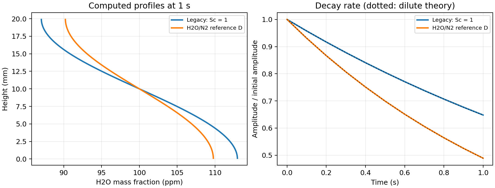

# chtReactingNanoParcelFoam

Fluid/solid conjugate heat transfer with reacting nano parcels, prescribed particle electric forcing, and independent dilute-species gas diffusion.

## Start with a physical tutorial

The main example is [H2O vapour diffusion in N2](tutorials/waterVapourDiffusion/README.md).
One `Allrun` computes two otherwise identical cases: the original Sc=1 transport
and the independent H2O/N2 diffusivity. It plots the resulting concentration
profiles and decay rates, so the purpose of the new transport equation is visible.
The supplementary [charged-particle drift case](tutorials/chargedParticleDrift/README.md)
uses the same physical gas-property model and checks a 10 nm particle against
Stokes-Cunningham theory in a prescribed field.

~~~sh
git clone https://github.com/Ryo-Shibui/chtReactingNanoParcelFoam.git
cd chtReactingNanoParcelFoam
source /path/to/OpenFOAM-v2406/etc/bashrc
./Allwmake
bash tutorials/waterVapourDiffusion/Allrun
~~~

Use the **OpenCFD/OpenFOAM.com** release family. Development headers, wmake,
compiler and matching runtime libraries are required. The executable/private
libraries are installed to `FOAM_USER_APPBIN`/`FOAM_USER_LIBBIN`. Do not replace
standard OpenFOAM libraries. Use separate build directories and output paths
when changing OpenFOAM releases; identical `WM_OPTIONS` does not imply ABI compatibility.

Python 3 and NumPy are needed for numerical comparisons. Matplotlib creates the
figures; CSV and numerical checks remain available without it. No Python package
is required by the solver itself. `./Allwclean` cleans build products.

At 320 K the computed diffusivity ratio is 1.6490. After 1 s, the concentration
amplitudes are 1.29594e-5 (legacy) and 9.77973e-6 (species-dependent D).

## Which solver to choose

| Solver | Carrier and solids | Electric field |
|---|---|---|
| reactingChargedNanoParcelFoam | One fluid region, dynamic-mesh framework | Prescribed E |
| chtReactingNanoParcelFoam | Static fluid/solid regions and CHT | Prescribed E for particles |
| multiRegionChargedNanoParcelEFFoam | Static fluid/solid regions, CHT, dielectric interfaces | Solved potential and E, or frozen E |

The reacting thermophysical/cloud infrastructure is retained even when equations
are skipped. These are not minimal isothermal kinematic solvers. All three provide
`nanoStokesDrag`, `CoulombSep`, native charge input/output, and independent dilute
gas diffusivities. `reactingNanoParcelFoam` and its shared libraries are unchanged.

## Layout and editable case inputs

~~~text
solver/         build sources only (fluid/, solid/, lagrangian/ where applicable)
tutorials/      physical, editable examples with native Allrun scripts
tests/          manufactured-property numerical regression cases
docs/           physical-property references, reproducible fitting code and figures
validation/     versioned numerical verification reports
~~~

The human tutorials now use native multi-line dictionaries, `0.orig/` initial
fields and `blockMeshDict`. `Allrun` restores initial fields and generates the
mesh; no precomputed mesh or solved checkpoint is needed from this repository.
Generated `0/`, time directories, meshes, logs and postprocessing are not tracked.
Read each tutorial's README before rerunning or editing its physical parameters.

### Exact diffusion dictionary locations

| Case type | Location |
|---|---|
| Single fluid region | `constant/speciesDiffusionProperties` |
| Named fluid region `fluid` | `constant/fluid/speciesDiffusionProperties` |

Every fluid case in the physical tutorials contains this dictionary, including
an explicit `model legacy` in the original-method comparison. Multi-region
case dictionaries belong to the region registry; putting only a root
`constant/speciesDiffusionProperties` into a named-region case will not configure it.

## Gas properties: actual species data

`thermophysicalProperties` selects:

~~~foam
thermoType
{
    type            heRhoThermo;
    mixture         reactingMixture;
    transport       sutherland;
    thermo          janaf;
    equationOfState perfectGas;
    specie          specie;
    energy          sensibleEnthalpy;
}
~~~

N2, O2, H2O and DEG in `foam.dat` have different molecular weights, thermodynamic
polynomials and viscosity data. `foam.inp` selects the active gas species:
the current examples activate only N2/H2O. Extra property entries do not activate
extra transport equations. Air should be specified as a mixture when required,
not created by renaming nitrogen.

For OpenFOAM's `mu = As*T^(3/2)/(T + Ts)` (Pa s), the tutorial coefficients are:

| Species | As (Pa s K^-1/2) | Ts (K) | Basis |
|---|---:|---:|---|
| N2 | 1.45251133780050e-6 | 123.027512608955 | Fit to Lemmon/Jacobsen (2004) |
| O2 | 1.74762288767855e-6 | 141.039392170230 | Fit to Lemmon/Jacobsen (2004) |
| H2O vapour | 2.02193323384903e-6 | 801.806493269838 | Fit to Huber et al. (2009) |
| DEG vapour | 8.38851e-7 | 451.903 | Retained supplied fit to Yaws (2014) |

N2/O2/H2O As/Ts are **our Sutherland fits to published zero-density viscosity
correlations**, not values copied from a published Sutherland table. The fit
interval is 300-600 K; maximum deviations from the source correlations are
0.199%, 0.199% and 2.385%, respectively. Those are fit errors, not the
experimental uncertainties. DEG's supplied fit covers 306.64-1000 K and has
not been independently refitted here. Wider JANAF polynomial bounds do not
validate the viscosity extrapolation.

The [property source document](docs/transportProperties.md), numerical source
data and `docs/fit_gas_transport.py` make the fitting reproducible. Recreating
the fits also requires SciPy; running the tutorials does not. NASA/JANAF
thermodynamic entries were retained from the supplied reference data, rather
than replaced with identical constant-Cp gases.

## Independent dilute-species transport

Set the background with native `inertSpecie N2;` in `thermophysicalProperties`.
Every other active species needs its own D when using `model dilute`. For H2O/N2:

~~~foam
model               dilute;
turbulentSchmidt    0.9;

species
{
    H2O
    {
        D                   [0 2 -1 0 0 0 0] 2.505362314376117e-5;
        Tref                298.15;
        pref                101325;
        temperatureExponent 2.072;
        pressureExponent    1;
    }
}
~~~

This follows Marrero and Mason (1972), Table 13/Figure 76:
`D = 1.87e-10*T^2.072*(101325/p)` m2/s, over 282-373 K, with approximately 4%
estimated uncertainty. It is a binary H2O/N2 correlation, not an air approximation.
The physical examples use 320 K within the overlapping property ranges.

For an active non-background mass fraction Yi the solver uses:

~~~text
Di = Dref,i * (T/Tref,i)^temperatureExponent,i * (pref,i/p)^pressureExponent,i
Gammai = rho*Di + mut/turbulentSchmidt
d(rho*Yi)/dt + div(phi*Yi) - div(Gammai*grad(Yi)) = Si
Ybackground = max(0, 1 - sum(solved non-background Yi))
~~~

`mut = muEff - mu`. The momentum viscosity is still supplied by the selected
mixture/turbulence model; D is an independent molecular property, not the
pure-species viscosity divided by density. Sources retain parcel, reaction,
film and fvOptions contributions. Temperature/pressure exponents default to
zero; positive D/Tref/pref and valid local absolute T/p are required.

An absent/empty dictionary or explicit `model legacy;` retains `Gamma=muEff`
(molecular and turbulent Sc=1). The supplied legacy tutorial uses the explicit
selection. Invalid explicit dilute input fails instead of silently reverting.
Coefficients are read at startup; restart after editing them.

This is a dilute mass-fraction Fick approximation against a dominant background,
not Maxwell-Stefan multicomponent transport. Cross diffusion, Soret,
barodiffusion and Eulerian species electromigration are absent. The pressure
exponent only changes D. Keep non-background species active and their total
loading small; nonzero inactive species and sums above one are outside the
documented closure. Convert Yi to mole fraction before computing partial pressure:
`xi=(Yi/Wi)/sum(Yj/Wj)`, then `pi=xi*p`.

## Native cloud and charged-particle controls

Keep the familiar `reactingCloud1Properties`, `solution`, `constantProperties`,
`subModels`, `singleMixtureFractionCoeffs` and `cloudFunctions` structure.
The supplementary/primary particle cases supply complete runnable dictionaries.
Use one drag model:

~~~foam
particleForces
{
    nanoStokesDrag
    {
        meanFreePath    6.5e-8;
    }

    CoulombSep
    {
        E               E;
    }
}
~~~

`nanoStokesDrag` is low-Re Stokes drag with Cunningham slip correction.
`sphereDrag` in these sources has no Cunningham correction; selecting both
adds their drags. Use native analytical U integration for stiff nano-particle
drag. `meanFreePath` or `lambda` specifies one constant SI mean free path;
it is not automatically scaled with local T/p.

`manualInjection` and `patchInjection` read `parcelCharge`: a signed number of
elementary charges, not coulombs. Thus q=`chargeNumber*1.602176634e-19 C` and
`CoulombSep` adds qE per physical particle. `nParticle` determines the parcel's
represented count. Native `chargeNumber` output is preserved on restart and
processor transfer; missing charge in older field-based clouds defaults to zero.
Keep a charged restart's charge file and use a matching scalar/label build.

Set stick/escape/rebound explicitly with native patch interaction. Tracking is
point-particle tracking. Brownian motion, image forces, dielectrophoresis,
gravity and other mechanisms are not automatically supplied by the two forces.
They are disabled in deterministic verification cases to expose electric drift.

`solution/coupled false` freezes parcel feedback; true enables implemented
mass/species/momentum/enthalpy source coupling. It does not create electric
space-charge feedback or a continuum gas charge equation.

## Select which equations to solve

Use `system/<fluid>/fvSolution/PIMPLE`:

~~~foam
PIMPLE
{
    solveFlow           false;
    solveSpecies        true;
    solveEnergy         false;
    solveParcels        false;
    nCorrectors         1;
    nNonOrthogonalCorrectors 0;
}
~~~

Defaults enable flow/species/energy/parcels. `solveFlow` overrides legacy
`frozenFlow`. Flow/species/energy flags are reread; `solveParcels` is startup-only.
`solveParcels false` avoids cloud/SLGThermo construction, but carrier thermo,
radiation and Eulerian film settings are still required. The solid also accepts
`PIMPLE/solveEnergy`. Fluid energy is independent of its species flag.

Global `system/fvSolution/PIMPLE/nOuterCorrectors` controls outer coupling.
Implicit assembled thermal coupling requires participating regions' energy
equations to be enabled; frozen-energy interfaces need compatible explicit
treatment. Region names and paths must match `constant/regionProperties`.

This solver reads/registers a prescribed named E when `CoulombSep` is
constructed; supply the field at the initial/restart time. It does not solve
dielectric electric potentials. The EF sibling is needed when dielectric
interfaces should determine E.

Use a steady carrier/field phase with parcels disabled, followed by transient
physical particle time. A steadyState iteration number is not flight time.
Disabling carrier energy does not disable particle heat transfer or phase
change; configure those cloud models separately. Startup thermo fields remain
necessary when their equations are frozen.

## DEG and phase change

The retained `liquidEvapFuchsKnudsen` supports pure liquid or liquid/solid input.
Activating DEG requires consistent carrier and cloud names, gas data, liquid
properties, vapour pressure/activity, and appropriate liquid diffusivity.
Its `liquidProperties::D(pc,Ts)` is separate from Eulerian gas D; changing
`speciesDiffusionProperties` does not change that phase-change property. The
new human cases verify H2O diffusion/electric tracking, not a predictive DEG
condensation experiment. Manufactured and pure-water model regressions remain
under `tests/`.

## Verification and limitations

Solver builds and numerical regressions were verified on OpenCFD v2406,
v2412 and v2506 (Ubuntu 24.04/WSL2, GCC 13.3, DP scalar64/label32;
v2412/v2506 official patch 260127). This revision also executes the new physical
tutorials on all three releases. [Versioned reports](validation/) distinguish
the earlier manufactured regression suite from the physical tutorial results.
They do not validate every platform, dynamic mesh, reactive chemistry model,
two-way conservation setup or DEG material correlation.

The source-only build folder stays separate from cases and result images.
Private library prefixes (`rcNano`, `chtNano`, `mrChargedEF`) avoid overwriting
common shared outputs; do not load older modified cloud libraries alongside them.
The CHT build uses the native particle base to avoid the former duplicate-library
shutdown error. Its extra tracking guard detects consecutive no-progress stalls,
not normal long trajectories. Injection now preserves the initial partial step
without advancing new particles twice.

## License

GPL-3.0-or-later, consistent with the OpenFOAM-derived source. Retain upstream
notices and [LICENSE](LICENSE) when redistributing.

## Direct links to the comparison inputs

- [Legacy diffusion selection](tutorials/waterVapourDiffusion/legacy/constant/fluid/speciesDiffusionProperties)
- [Independent H2O diffusion selection](tutorials/waterVapourDiffusion/speciesDependent/constant/fluid/speciesDiffusionProperties)
- [Species gas properties](tutorials/waterVapourDiffusion/speciesDependent/constant/fluid/foam.dat)
